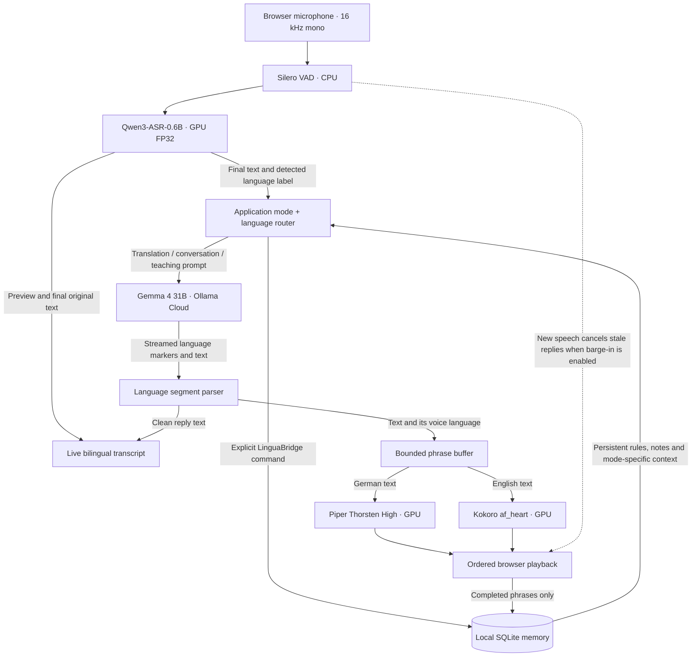

# LinguaBridge STS — English–German Speech-to-Speech Translation & Conversation

An audio-to-audio (speech-to-speech / STS) application for English and German, built as a streaming STT → LLM → TTS pipeline.

A hands-free interpreter for two people sharing a microphone, with bilingual conversation, teaching, and persistent local memory. Start in conversation mode. After you explicitly confirm translation, English produces German and German produces English. The microphone stays ready while the next person takes their time.

Built by **Bola Maged Ramses Nessim**. This independent project lives beside `voice-conversation`; it has no runtime dependency on that checkout. The setup below is self-contained; model weights and private memory are downloaded or created locally.

[](https://bmaged23.github.io/linguabridge-en-de-sts/demo.html)

A rainy Saturday in Berlin: a 13-turn English/German story with mixed-language speech, a real voice interruption, confirmed two-way translation, and memory recall. The speakers are synthesized; assistant responses run live through the real pipeline. The cover opens the video player; while the app is running, it is available at **http://localhost:8766/docs/demo.html**. See [recording details](docs/demo/README.md). This demo was recorded before the LinguaBridge STS rename, so the original Bridge branding and spoken name appear in the video. The demo player and animated pipeline are served through GitHub Pages.

## Voice pipeline — inputs and outputs



[Open the animated pipeline](https://bmaged23.github.io/linguabridge-en-de-sts/architecture.html). Open this HTML locally or via the running app at **http://localhost:8766/docs/architecture.html**. The diagram is illustrative; timing is not a measured performance trace.

VAD identifies speech and pauses. Qwen attempts verbatim English/German transcription and returns a language label, without calibrated confidence. Mixed-language recognition can still translate or misrecognize words. Application code chooses the main output language. The LLM marks the actual English/German spans, and each span uses its matching TTS voice. The LLM receives final text, not raw microphone audio. Qwen uses cumulative progressive previews with text-prefix reuse; Kokoro (English) and Piper (German) produce short synthesized phrases while the cloud response continues streaming. A reply can switch English → German → English or German → English → German within one sentence. Internal language markers are hidden from the transcript and saved memory. No additional classifier or LLM call is used. Opening [en]/[de] markers select the voice. The parser tolerates repeated markers, optional closing tags, and punctuation at boundaries so these formatting variations do not cancel the reply. Unmarked text uses the selected main reply language. See [mixed-output samples](docs/mixed-output-check/index.html).

## Modes and timing

| Mode | Behavior | Silence before ending a turn |
| --- | --- | --- |
| Translate — after confirmation | Faithful EN → DE or DE → EN, no answers or commentary | 1,200 ms, effective 1,216 ms at 32 ms/frame |
| Conversation — initial default | Answer naturally; match input language or use your selected language | 700 ms, effective 704 ms |
| Teaching | Explain, give an example, and check understanding | 1,000 ms, effective 1,024 ms |

There is **no idle turn timeout** between speakers. Consecutive English inputs both produce German. These starting thresholds are configurable. Language detection is uncertain on very short words: LinguaBridge uses recent language context and the relative English/German scores when appropriate. It speaks a clarification when it cannot route reliably, and displays notices beside the microphone controls. It does not identify people or separate overlapping speakers.

Voice interruptions are **on by default in every mode**. The browser keeps sending microphone frames during replies; after 320 ms of continuous speech meeting the VAD/RMS thresholds, the server tells the browser to stop playback before waiting for response cancellation. Queued audio is cleared and stale inference results are discarded. Use headphones to reduce acoustic feedback. Disable **Interrupt replies by voice** in Audio settings to pause microphone input during reply playback. Browser echo cancellation is requested in either case.

## Models and runtime

| Stage | Active model / voice | Runs on | Input → output |
| --- | --- | --- | --- |
| Voice activity | Silero VAD ONNX | Local CPU | Audio frames → speech start/end |
| Speech recognition | Qwen3-ASR-0.6B, FP32, eager attention | Local NVIDIA GPU | English/German/mixed audio → partial and final text |
| Conversation / translation | `gemma4:31b` through Ollama Cloud | Provider hardware | Final text + selected memory → streamed bilingual text |
| English speech | Kokoro 82M ONNX, `af_heart`, speed 1.05 | Local NVIDIA GPU | English phrases → audio |
| German speech | Piper `de_DE-thorsten-high` | Local NVIDIA GPU | German phrases → audio |
| Memory | SQLite | Local disk | Modes, notes, history and summaries |

The LLM runs remotely and takes no local VRAM. Only finalized text, selected history and relevant notes/summaries go to Ollama Cloud. The browser sends audio to the local server. TTS streams **completed phrase chunks**, not partial waveforms within a phrase. STT uses progressive cumulative-audio decoding with prefix reuse, not a native streaming decoder. One microphone is shared; the app does not identify speakers or separate overlapping voices.

## Requirements

| Item | Tested setup |
| --- | --- |
| OS | Linux x86_64 / WSL2 with NVIDIA GPU access |
| Python | 3.12; installed snapshots captured on 3.12.15 |
| GPU | NVIDIA GTX 1660 Ti, 6 GB VRAM |
| RAM | About 7.7 GiB visible to WSL during tests |
| Browser | Chromium/Chrome/Edge with microphone permission on localhost |
| Cloud | Ollama API key, access to `gemma4:31b`, internet connection |
| Storage | Several GB for speech weights, plus Python/CUDA environments and download caches |
| Installer | `uv` available in your terminal; the installed environments do not include pip |

Native Windows/macOS installation has not been validated. On Windows, run Python in WSL2 and open localhost in your desktop browser. No local Ollama server or LLM download is needed.

## Clone / install / run

### 1. Open or clone this project

If you already have the project, open a terminal in its folder. To clone the published repository:

```bash
git clone https://github.com/bmaged23/linguabridge-en-de-sts.git
cd linguabridge-en-de-sts
```

Install Python 3.12 and `uv` before proceeding. The exact snapshots target Linux x86_64, Python 3.12 and the CUDA configuration above.

### 2. Create the three independent environments

Run every command from the project root:

```bash
uv venv .venv --python 3.12
uv pip install --python .venv/bin/python --no-deps -r requirements.txt

uv venv .venv-asr --python .venv/bin/python
uv pip install --python .venv-asr/bin/python --no-deps -r requirements/stt-cuda.txt

uv venv .venv-tts-gpu --python .venv/bin/python
uv pip install --python .venv-tts-gpu/bin/python --no-deps -r requirements/tts-cuda.txt
```

These files contain exact `==` versions of **all installed distributions**, including transitive dependencies, CUDA packages and test tools. `--no-deps` reproduces the snapshot instead of resolving additional versions. The app and GPU TTS snapshots end with portable `-e .` entries that install this checkout. The ASR file includes the PyTorch CUDA 12.4 wheel index. Creating these environments requires downloads; use a trusted package source.

| File | Environment | Installed distributions, excluding the editable project |
| --- | --- | ---: |
| [`requirements.txt`](requirements.txt) | `.venv`: app, VAD and QA | 79 |
| [`requirements/stt-cuda.txt`](requirements/stt-cuda.txt) | `.venv-asr`: deployed Qwen recognizer | 109 |
| [`requirements/tts-cuda.txt`](requirements/tts-cuda.txt) | `.venv-tts-gpu`: deployed GPU voices | 79 |
| [`requirements/experimental-qwen-tts.txt`](requirements/experimental-qwen-tts.txt) | `.venv-qwen-tts`: optional experimental TTS | 112 |

The fourth environment is an installed experiment and is **not required to run LinguaBridge**. Its file is retained for reproducibility. Do not merge the requirement files: the app uses CPU `onnxruntime` for VAD while the isolated TTS runtime uses `onnxruntime-gpu`; ASR has its own PyTorch/Transformers versions. Older evaluation snapshots under `requirements/archive/` remain historical; use the root snapshots above for this deployed setup.

Dependency checks:

```bash
uv pip check --python .venv/bin/python
uv pip check --python .venv-asr/bin/python
uv pip check --python .venv-tts-gpu/bin/python
```

The first two checks passed on the captured installation. GPU TTS currently reports six metadata incompatibilities: four dependencies ask for CPU `onnxruntime` despite using the GPU package's `onnxruntime` module, and `onnxruntime-gpu` lists missing `coloredlogs` and `sympy` dependencies. These files reproduce that working but imperfect environment; they do not claim a clean dependency check. Do not co-install CPU and GPU ONNX Runtime in the same environment. A clean-machine reinstall has not yet been tested.

[`uv.lock`](uv.lock) is the older main-project resolution; `uv sync` is **not equivalent** to reproducing all three installed snapshots. To refresh and verify the snapshots without installing or changing packages:

```bash
.venv/bin/python -m scripts.dependencies.export_installed_versions
.venv/bin/python -m scripts.dependencies.export_installed_versions --check
```

### 3. Configure Ollama Cloud

```bash
cp .env.example .env
chmod 600 .env
```

Edit `.env` locally:

```dotenv
OLLAMA_API_KEY=your_own_key
OLLAMA_BASE_URL=https://ollama.com
OLLAMA_MODEL=gemma4:31b
```

Keep an existing configured `.env` rather than overwriting it. Credentials stay server-side. The credential destination is restricted to `https://ollama.com`. Cloud checks and conversations consume your account allowance.

### 4. Download the speech models

```bash
.venv/bin/python -m scripts.setup.download_speech_models
```

The downloader retrieves the configured Qwen checkpoint, Silero VAD ONNX, Kokoro ONNX/voice embeddings and German Piper voice/config/model card. Pinned revisions and SHA256 hashes are recorded in [`docs/reference/model-manifest.json`](docs/reference/model-manifest.json) and local `models/assets.json`. Model weights and caches are ignored by Git; they are not copied from the old conversation project. No research dataset is needed to run the app.

### 5. Check configuration and start

```bash
nvidia-smi
.venv/bin/python -m scripts.validation.validate_configuration
.venv/bin/python -m scripts.application.start_voice_app
```

Open **http://localhost:8766**, click **Start conversation**, and allow microphone access. The server loads and warms the local GPU models before becoming ready. Use this launcher so the speech workers receive the project-local CUDA library paths. Keep the terminal running; **Ctrl+C** stops the server. Restart after editing `config.py`.

Try an English sentence, a German sentence, then a mixed sentence such as “Can you explain what Ich habe den Zug verpasst means?” Speak during a reply to interrupt it. Translation requires an explicit confirmation; it then stays active across sessions until changed. The browser Audio settings provide microphone selection, assistant volume and the voice-interruption toggle.

## Hands-free control and persistent memory

The mode lives in SQLite rather than relying on the LLM to remember an instruction. The fresh-project default is conversation, with replies matching the speaker’s language. Enabling translation or changing the conversation/teaching reply language first creates a confirmation request; the current settings remain active until you say yes or click Yes, confirm. Say no or click Cancel to keep the current settings. Requests expire after 45 seconds. Confirmed translation then persists until explicitly changed; it does not ask on every turn. Older unconfirmed translation settings are migrated to conversation without deleting history. It survives reconnecting, refreshing, and restarting the server. Changing `modes.default` only affects a new database; select a mode in the UI to change an existing saved setting.

Use the mode controls or explicit commands:

| Say | Result |
| --- | --- |
| “LinguaBridge, translator mode.” | Ask to enable English ⇄ German translation; say yes to activate |
| “LinguaBridge, I will speak English, translate into German.” | Ask to enable the same bidirectional translator |
| “Brücke, Übersetzungsmodus.” | Ask to enable translation |
| “LinguaBridge, conversation mode.” / “Brücke, Gesprächsmodus.” | Bilingual conversation |
| “LinguaBridge, teaching mode.” / “Brücke, Lernmodus.” | Teaching mode |
| “LinguaBridge, reply in German.” | Ask to save German as the conversation/teaching reply language |
| “LinguaBridge, reply in the same language.” | Return to matching the speaker |
| “LinguaBridge, remember that my German level is A2.” | Save an explicit note across sessions |
| “LinguaBridge, what do you remember?” | Read saved notes |

The `LinguaBridge` / `Brücke` prefix (with `Bridge` retained as a compatible alias) distinguishes app commands from dialogue being translated. Prefix-free instructions in translator mode are translated as content. Supported command patterns are deterministic, not unrestricted natural-language command understanding. Use the UI if a name or command is misrecognized.

Memory has separate layers:

1. **Operating state:** mode and response-language preference; injected on every request and never overwritten by a summary.
2. **Pinned notes:** explicit user facts/preferences, editable in the memory panel. Used in conversation and teaching; not inserted into translation text.
3. **Recent history:** separate for each mode, including original text and only fully played assistant phrases. Interrupted/unplayed text is not claimed as heard.
4. **Older summaries:** after 20 unsummarized turns, compact older conversation/teaching context while preserving 12 recent turns. Summaries run after the reply with a four-second deadline, preserving the previous summary and raw history if they fail. Summaries can lose details; pin facts that must remain exact.

“Clear this history” clears the current mode's history/summary, retaining pinned notes and mode. “Erase all notes and conversation history” clears all three histories, summaries, and notes while retaining operational mode/language settings. Stop the microphone before deleting `data/memory.sqlite3` manually. Set `memory.persist_transcripts=False` to keep new raw turn history only for the active session; operating settings and explicit notes still persist.

## Configuration

Every tuning setting is in [`config.py`](config.py); the complete table is in [`docs/reference/configuration-parameters.md`](docs/reference/configuration-parameters.md). Restart after editing settings.

| Area | Initial setting |
| --- | --- |
| STT | Qwen3-ASR-0.6B, CUDA FP32, eager attention |
| Language routing | Qwen EN/DE label plus recent language context; no calibrated Qwen confidence score |
| STT previews | Every ≥2,000 ms, cumulative window up to 46 seconds |
| VAD | Speech threshold 0.5, RMS ≥0.002, 200 ms continuous start; interruption threshold 0.8, RMS ≥0.006, 320 ms |
| Speaker echo | Microphone paused during playback plus a 250 ms tail; headphones can opt into voice interruptions |
| Maximum turn | Translation/teaching 45 s; conversation 30 s |
| LLM | Gemma 4 31B, streaming, thinking off, temperature 0.3, 512 response tokens |
| Bilingual output | `tts.language_segments.enabled=True`; streamed EN/DE markers select a voice per phrase |
| TTS | English Kokoro `af_heart` at 1.05; German Piper Thorsten at length scale 1.0; GPU |
| Concurrency | One Qwen GPU process + one shared GPU TTS process; one browser session |
| Queues | 32 token entries, 3 text phrases, 3 pending playback chunks |
| Voice interruptions | Enabled by default; 320 ms continuous speech, VAD 0.8, minimum RMS 0.006 |
| Phrase boundaries | 40–180 characters; 350 ms safe-boundary flush |
| Memory | Local `data/memory.sqlite3`; 12 recent turns; summary trigger 20 |
| Server | `127.0.0.1:8766`; same-origin local controls |

See [measured GPU latency and resource use](docs/reports/gpu-performance.md). The separate [Qwen versus Kokoro/Piper evaluation](docs/reports/speech-synthesis-comparison.md) includes WER/CER from two recognizers, generation speed, CPU/RAM/VRAM, and [playable samples](docs/tts-comparison/index.html). Qwen TTS remains an evaluation candidate; deployed voices are unchanged.

Cloud reply text has a 15-second first-token deadline and a 15-second idle deadline. Empty or thinking-only packets cannot keep the reply waiting forever. A timeout displays an error and returns the session to listening; saved history is retained. These deadlines are configurable in `config.py`.

## Verification

```bash
source .venv/bin/activate
python -m pytest -q
python -m scripts.application.start_voice_app -m scripts.validation.validate_speech_models
python -m scripts.validation.validate_cloud_connection
python -m scripts.validation.validate_translation  # live semantic-anchor regression checks
python -m scripts.validation.validate_conversation  # English conversation must reply in English
# With the local server running:
python -m scripts.validation.validate_voice_session
python -m playwright install chromium  # one-time browser QA dependency
python -m scripts.validation.validate_browser_interface
```

Offline tests exercise persistence across reopen, mode separation, command isolation, language confidence, playback memory, summary boundaries, VAD timing, and microphone resampling. Speech smoke synthesizes German/English with Piper/Kokoro and recognizes the generated audio on GPU. Session smoke makes real cloud calls, checks EN→DE twice, DE→EN, correct TTS routing, and a six-second idle pause. Its synthetic turns appear in local translation history. Browser checks use a test microphone; physical microphone quality, room echo, accents, and overlapping speech require testing on your own device. Cloud checks consume account quota.

Synthetic smoke tests are functional checks. The separate [advanced story report](docs/advanced-story/SUMMARY.md) includes reference-based WER/CER measurements and their limitations; those scores are not human microphone benchmarks. Compare models on held-out human recordings before choosing a quality upgrade. Qwen ASR is the active recognizer. Qwen TTS exists only in the isolated experimental environment and is not used by the app.

## Project layout

See the [tools and command guide](scripts/README.md), [documentation index](docs/README.md), and [dependency environment guide](requirements/README.md). Grouped tools run as Python modules from the repository root, so their imports work across folders. The [rename map](docs/reference/filename-migration.json) lists previous filenames.


```text
linguabridge-en-de-sts/
  .env / .env.example    Private credentials / shareable template
  .venv*/               App, ASR, GPU TTS and optional experiment environments (ignored)
  config.py             All tuning and memory settings
  requirements.txt      Exact main app dependencies
  requirements/         Exact GPU STT/TTS and experimental environment snapshots
  uv.lock               Older main-project dependency resolution
  src/voice_bridge/     VAD, routing, SQLite memory, workers, API
  web/                  Local browser interface and AudioWorklet
  scripts/
    application/        Voice app launcher
    setup/              Speech-model download and verification
    dependencies/       Installed package snapshot exporter
    runtime/            Persistent Qwen GPU worker
    demo/               Recording, video cover and media checks
    validation/         Configuration and end-to-end app checks
    evaluation/         ASR/TTS comparisons and profiling
    story_tests/        Continuous bilingual stories and resource monitoring
    reports/            Research report and dashboard exporters
    archive/            Historical one-off audit orchestration
  tests/                Offline behavior tests
  docs/
    guides/             Runtime setup and advanced testing instructions
    reference/          Configuration, model manifest and filename migration map
    reports/            Evaluation write-ups and structured results
    demo/               Video, cover, captions and transcript
    advanced-story/     Interactive story test dashboard and synthetic audio
    full-qa/            Full pipeline validation artifacts
    mixed-output-check/ Bilingual speech output samples
    tts-comparison/     Speech synthesis comparison samples
  models/               Local speech weights (ignored)
  data/                 Private memory database (ignored)
  logs/                 Test audio and reports (ignored)
  description/          Private project brief + old presentation references (ignored)
```

The ignored `description/PROJECT_BRIEF.md` and `description/reference/` preserve the README, animated diagram, clickable cover, real-conversation demo approach, and reproducibility requirements for future documentation. They are independent copies. The old project is not deleted by setup. This private design folder will not appear in a future clone unless you back it up separately.

## Models and notices

- [Qwen3-ASR-0.6B](https://huggingface.co/Qwen/Qwen3-ASR-0.6B) and [Qwen implementation](https://github.com/QwenLM/Qwen3-ASR), Apache-2.0.
- Optional legacy baseline: [Whisper Turbo original model](https://huggingface.co/openai/whisper-large-v3-turbo) and [CTranslate2 conversion](https://huggingface.co/dropbox-dash/faster-whisper-large-v3-turbo), MIT.
- [faster-whisper](https://github.com/SYSTRAN/faster-whisper), MIT.
- [Silero VAD](https://github.com/snakers4/silero-vad), MIT.
- [Kokoro ONNX](https://github.com/thewh1teagle/kokoro-onnx) and [Kokoro 82M](https://huggingface.co/hexgrad/Kokoro-82M) provide English speech; retain their respective model/runtime notices.
- [Piper runtime](https://github.com/OHF-Voice/piper1-gpl), GPL-3.0; retain its license obligations when distributing software.
- Voice licenses are separate from the engine: the [Thorsten card](https://huggingface.co/rhasspy/piper-voices/blob/main/de/de_DE/thorsten/high/MODEL_CARD) names a CC0 dataset. Its model card is downloaded beside the German voice. English uses Kokoro’s model and voice embeddings. Do not assume the repository-wide license covers every voice's training material.
- [Gemma 4 31B model card](https://huggingface.co/google/gemma-4-31B-it); hosted by Ollama Cloud. Availability, quota, pricing and latency depend on your account/provider.

Live audio stays local. Test scripts can save audio under ignored `logs/`; reviewed synthetic reports/audio under `docs/` are shareable Git content. Finalized text, selected recent history, and relevant notes/summaries are sent to Ollama Cloud. Raw conversation text persists locally by default for memory; it is not written to ordinary server logs. `.env`, `description/`, models, data, caches and logs are excluded from Git.

## Troubleshooting

- **Missing CUDA libraries:** use the project `.venv` and `scripts/application/start_voice_app.py` launcher; verify driver access with `nvidia-smi`.
- **Cloud response fails:** check the local `.env`, model access and quota. Credentials/provider bodies are not printed.
- **No response:** check the microphone waveform and the notice beside its controls. The app displays recognition progress, warns if it has never detected microphone signal, and speaks a clarification for ambiguous language. Local `/diagnostics` reports pipeline stage and input levels without recording audio or text.
- **Wrong language on a short phrase:** speak a fuller English/German sentence. Detection is not speaker identification.
- **Replies feed back into the microphone:** use headphones, or turn off voice interruptions in Audio settings. For forced translation suppression, set `modes.translation.suppress_microphone_during_playback=True`.
- **Cannot interrupt:** refresh the page after updating, start a new session, enable **Interrupt replies by voice**, and check `/diagnostics` for microphone levels and speech detections. Defaults require 320 ms of continuous speech, VAD probability 0.8 and RMS 0.006.
- **Dependency check fails in GPU TTS:** see the exact-snapshot caveats above; avoid installing CPU ONNX Runtime over the GPU package.
- **Translation did not enable immediately:** answer the confirmation prompt. Merely mentioning German or translation does not change settings.
- **Voice command was translated:** repeat the explicit “LinguaBridge” / “Brücke” prefix, or use mode controls.
- **Long pauses split a sentence:** increase that mode's `end_of_turn_silence_ms` in config.
- **Old context appears:** review pinned notes and clear the relevant mode's history; clearing one mode does not erase the others.
- **Port occupied:** change `server.port`; the original project uses 8765, LinguaBridge uses 8766.

Full pipeline diagnostics and known limitations: [test report](docs/reports/full-pipeline-validation.md).

[Advanced continuous bilingual story testing](docs/guides/advanced-story-testing.md) records every pipeline stage and per-sample RAM/VRAM measurements.
