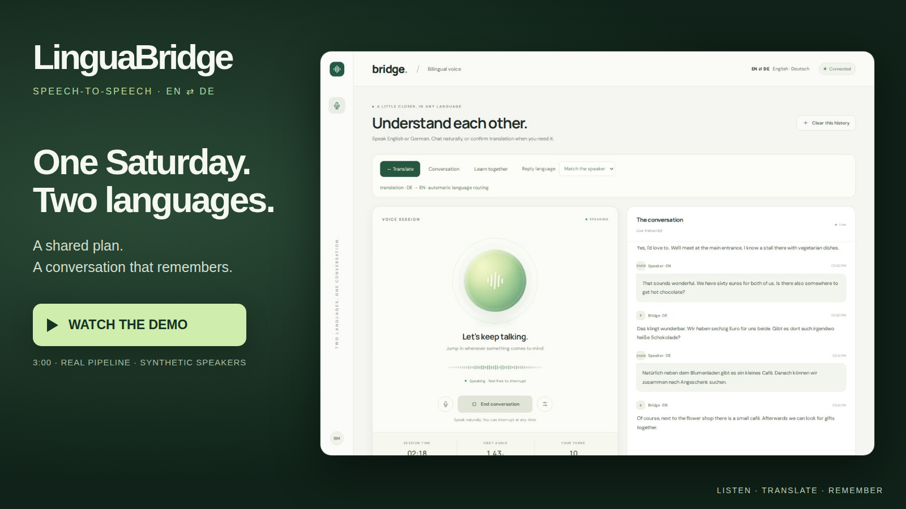
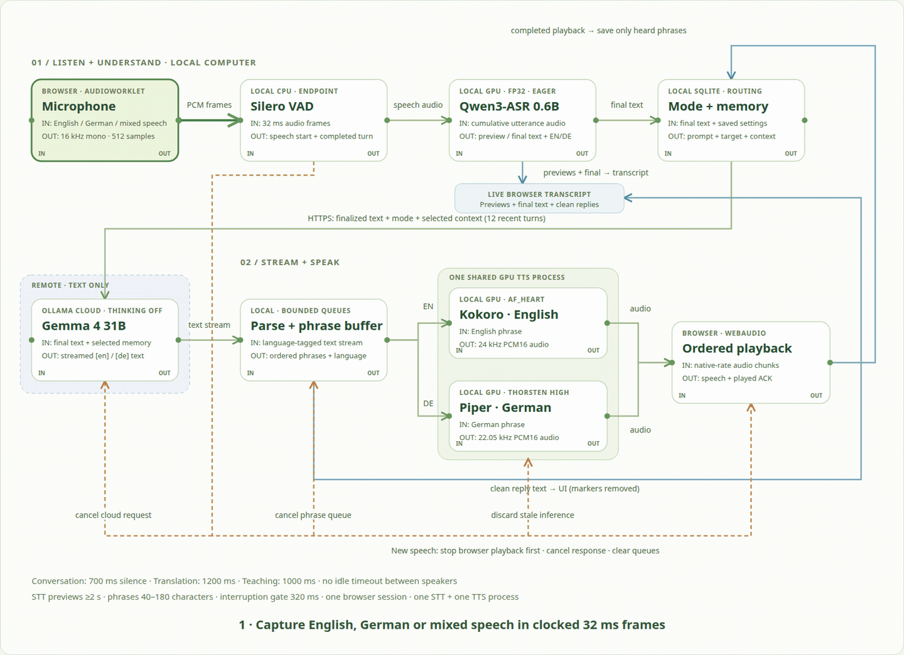

# LinguaBridge STS — English–German Speech-to-Speech Translation & Conversation

**Speak English, German, or a mixture of both—and hear the AI respond.** LinguaBridge is an audio-to-audio app for bilingual conversation, interpreting between two people, and practising German or English. It remembers your confirmed mode, saved notes, and conversation context across sessions.

The pipeline is **microphone → speech-to-text (STT) → language model (LLM) → text-to-speech (TTS) → speakers**. Speech recognition and speech synthesis run on your local NVIDIA GPU. The language model runs on Ollama Cloud. This is a modular speech-to-speech system: the LLM receives transcribed text rather than raw audio.

Built by **Bola Maged Ramses Nessim**.

[Demo](#demo) · [Animated pipeline](#animated-pipeline) · [Models](#models) · [Installation](#installation--clone-to-first-conversation) · [Configuration](#important-configuration) · [Troubleshooting](#troubleshooting)

## Demo

[](https://bmaged23.github.io/linguabridge-en-de-sts/demo.html?v=2)

Click the play cover to watch a **three-minute, 13-turn story**: planning a Saturday in Berlin, interrupting an answer, switching between English and German, confirming translator mode, and recalling a saved detail. User voices are synthesized; assistant replies come from the real running pipeline. The original recording uses the earlier “Bridge” branding. [Recording details and transcript](docs/demo/README.md).

## Animated pipeline

[](https://bmaged23.github.io/linguabridge-en-de-sts/architecture.html?v=2)

The animation plays directly in this README. Click it for the interactive version, where you can pause the animation and select individual entities. It illustrates the flow, not measured latency.

1. **Capture speech.** Your browser requests echo cancellation and noise suppression, then sends 16 kHz mono audio to the local server in 512-sample frames—32 ms each.
2. **Detect a turn.** Silero VAD distinguishes speech from silence. Each mode has its own pause allowance; translation waits longer so speakers can finish their sentences.
3. **Transcribe.** Qwen3-ASR produces replaceable previews while you speak. Short requests receive a fresh whole-turn final decode. Long requests also probe speech-bounded pause chunks; their joined result is used only when both supported languages have sufficient evidence. Monolingual or unreliable chunks fall back to the original whole-turn decoder. Only finalized text goes to the LLM.
4. **Build the request.** The app adds the confirmed mode, target language, and relevant local memory. Gemma streams its answer or translation through Ollama Cloud.
5. **Choose the voices.** The LLM marks English/German text spans. A local parser removes these markers from the transcript and sends short phrases to Kokoro or Piper. English → German → English output can switch voices within a reply while preserving order.
6. **Play and remember.** The browser plays each completed audio chunk. Only fully played assistant phrases count as heard history. New speech stops playback, clears pending audio, and cancels the previous response.

STT receives cumulative audio previews while you speak. Short previews use progressive prefix reuse; longer inputs can decode completed pause segments early. Exact audio/settings matches let the final pass reuse completed segments, while the unfinished tail is decoded again. GPU batches of two reduce repeated work. The original whole-input fallback remains for monolingual or uncertain cases. TTS streams completed **phrases**, rather than individual audio tokens. One STT process and one shared TTS process keep their models loaded between turns.

## Models

| Stage | Model / voice | Location | Active settings |
| --- | --- | --- | --- |
| Speech detection | Silero VAD ONNX | Local CPU | 16 kHz audio, 32 ms frames |
| STT | Qwen3-ASR-0.6B | Local GPU | FP32/eager; greedy short/whole decoding, 3-beam long chunks; exact segment cache and batches of 2 |
| LLM | `gemma4:31b` | Ollama Cloud | Streaming on, thinking off, temperature 0.3 |
| English TTS | Kokoro 82M ONNX, `af_heart` | Local GPU | Speed 1.05, 24 kHz output |
| German TTS | Piper `de_DE-thorsten-high` | Local GPU | Length scale 1.0, 22.05 kHz output |
| Memory | SQLite | Local disk | Mode, notes, recent turns and summaries |

No local LLM installation is required. An Ollama Cloud account with access to the configured model is required. Model weights download separately from the repository. See the [pinned model manifest](docs/reference/model-manifest.json) and [model notices](docs/reference/model-notices.md).

## Measured evaluation

Latest: the [noisy mixed-speech fix](evaluation/results/mixed-asr-fix-2026-10-24/README.md) reduced validation-story WER from **14.32% to 9.40%** on four source stories with clean/20 dB/10 dB variants. All 24 human calibration transcripts retained their baseline scores. The previously failing noisy story now passes explicit cancellation/negation checks, including independent checks of both spoken summaries. **17/17 browser turns** passed the stronger suite; The current offline suite passes **93 regression tests**; the linked accuracy checkpoint originally had 83.

The prior scripted full flow measured **2.31% WER / 0.51% CER** and **2.75 s median first audio after input recording**. Completed-segment caching and GPU batches of two subsequently reduced the long mixed story’s first-audio delay from **7.77 s to 2.69 s** in matched real-time browser runs, with unchanged transcription. Offline final-decode comparisons preserved all 52 transcripts. See the [latency and accuracy report](evaluation/results/asr-latency-optimization-2026-10-24/README.md) for scope and measurements. Six of 45 validation fact checks still fail under noise; recognition is not error-free.

| Native STT evaluation | WER | CER | Scope |
| --- | ---: | ---: | --- |
| English human speech | 3.77% | 2.05% | 12 FLEURS calibration recordings |
| German human speech | 4.42% | 2.03% | 12 FLEURS calibration recordings |
| Mixed validation speech | 9.40% | 6.72% | Four synthetic stories × clean/20 dB/10 dB conditions |

These cohorts differ and are not a single multilingual accuracy score. The model’s training overlap with the human calibration clips is unknown. The [component report](evaluation/results/component-v1/README.md) and [guarded mixed-speech report](evaluation/results/mixed-asr-fix-2026-10-24/README.md) describe the inputs and limitations.

Independent Whisper scored **37/37 generated audio chunks** without execution failures: English text/audio agreement WER **4.23%**, CER **2.95%**; German WER **9.01%**, CER **7.38%**. Review of every discrepancy found number/time spelling differences, such as “ten” versus “10”. These are automatic agreement measurements with a known language, not human voice-quality scores. See the [native audio audit](evaluation/results/asr-latency-optimization-2026-10-24/audio-audit-summary.json).

The earlier [teaching and voice-marker fix](evaluation/results/teaching-voice-fix-2026-10-24/README.md) passed a 12-case teaching regression suite in two passes. Its two previously failing turns produced 10 native audio chunks with 0% normalized WER/CER in an independent Whisper check. Historical measurements and known failures remain in the [earlier evaluation](evaluation/results/review-2026-10-24/README.md).

On six matched texts, GPU streamed synthesis took **0.47 s median versus 2.64 s on CPU** (5.61× for synthesis only). The reports include actual-audio Whisper scores, model-judge coverage, RAM/VRAM/CPU measurements and retained failures.

On 24 human FLEURS clips, the enabled strategy retained **3.77% English / 4.42% German WER**. The [component report](evaluation/results/component-v1/README.md) preserves the original progressive-decoding, independent TTS, endpointing and translation measurements. These small read-speech/development sets do not establish general accuracy or naturally code-switched human speech performance.

All 24 production-streamed TTS cases completed; one unbounded long-text baseline failed its memory allocation. The [first full browser run](evaluation/results/browser-v1/README.md) and [fresh-final follow-up](evaluation/results/browser-v2/README.md) preserve the original recognition, completeness and marker failures. See [evaluation methods and limitations](evaluation/README.md) for the later fixes and remaining recognition issue.

## Installation — clone to first conversation

### 1. Check your machine

| Requirement | Tested setup |
| --- | --- |
| Operating system | Linux x86_64 or WSL2 |
| GPU | NVIDIA GPU; tested on GTX 1660 Ti with 6 GB VRAM |
| Python | 3.12; package snapshots captured on 3.12.15 |
| RAM | Approximately 7.7 GiB available to the tested WSL instance |
| Storage | Allow at least 15–20 GB for the environments, models and caches |
| Browser | Chrome, Chromium or Edge, with microphone permission on localhost |
| Cloud access | Internet connection and an Ollama API key |

On Windows, run the following commands **inside WSL2**, and use your normal desktop browser for the microphone. Native Windows and macOS setups have not been validated.

Check GPU access before installing:

```bash
nvidia-smi
```

### 2. Install uv and Python

Install Git if it is not already available. Install [uv using its official installer](https://docs.astral.sh/uv/getting-started/installation/):

```bash
curl -LsSf https://astral.sh/uv/install.sh | sh
```

Open a new terminal so `uv` is on your PATH, then install Python 3.12:

```bash
uv --version
uv python install 3.12
```

### 3. Clone the project

```bash
git clone https://github.com/bmaged23/linguabridge-en-de-sts.git
cd linguabridge-en-de-sts
```

Run all remaining commands from this repository folder.

### 4. Create the environments and install the exact requirements

The app, recognizer and GPU voices have separate environments so their ONNX Runtime and PyTorch dependencies do not conflict.

```bash
# Main app, CPU VAD and testing tools
uv venv .venv --python 3.12
uv pip install --python .venv/bin/python --no-deps -r requirements/release/app.txt
uv pip install --python .venv/bin/python --no-deps -e .

# Qwen GPU speech recognition
uv venv .venv-asr --python .venv/bin/python
uv pip install --python .venv-asr/bin/python --no-deps --index-strategy unsafe-best-match -r requirements/stt-cuda.txt

# Kokoro / Piper GPU speech synthesis
uv venv .venv-tts-gpu --python .venv/bin/python
uv pip install --python .venv-tts-gpu/bin/python --no-deps -r requirements/release/tts.txt
```

These release files pin runtime distributions, including transitive dependencies. `--no-deps` reproduces those versions without adding a separately resolved dependency set. The recognizer provides shared CUDA libraries; the main environment uses CPU ONNX Runtime for VAD and the voice environment uses GPU ONNX Runtime. Keep those ONNX distributions separate. The original complete installed-environment snapshots remain in `requirements.txt` and `requirements/*-cuda.txt`. The optional Qwen TTS experiment is not needed.

**Reproducibility note:** a clean release application environment passes all offline tests and dependency checks. The release TTS file supplies two helper dependencies absent from the historical snapshot. Its Piper/Kokoro metadata still names the CPU ONNX distribution although the GPU package provides the required module; co-installing both is not the fix. Native reinstall of all three environments has not been independently certified on another machine. See the [environment details](requirements/README.md) and the container verification status below. `uv sync` uses an older main-app lock and does not replace the three steps above.

### 5. Add your Ollama Cloud credentials

```bash
cp .env.example .env
chmod 600 .env
```

Open `.env` in your editor and fill in your key:

```dotenv
OLLAMA_API_KEY=your_own_ollama_api_key
OLLAMA_BASE_URL=https://ollama.com
OLLAMA_MODEL=gemma4:31b
```

Keep an already configured `.env` when updating an existing checkout. It is ignored by Git. Your key stays server-side, and cloud calls consume your account allowance.

### 6. Download the speech models

```bash
.venv/bin/python -m scripts.setup.download_speech_models
```

This downloads Qwen3-ASR, Silero VAD, Kokoro and its voice embeddings, and the German Piper voice/configuration. It uses pinned revisions and verifies recorded hashes. No training dataset is needed to run the app.

### 7. Validate the settings and start the app

```bash
.venv/bin/python -m scripts.validation.validate_configuration
.venv/bin/python -m scripts.application.start_voice_app
```

Wait for **Application startup complete**, then open **http://localhost:8766**. The first launch loads and warms the GPU models. Keep the terminal running. Use the launcher above so speech workers receive the correct CUDA library paths.

### 8. Start your first conversation

Click **Start conversation**, allow microphone access, and speak. Headphones help prevent speaker echo.

- Try English: “Help me plan a weekend in Berlin.”
- Try German: “Was können wir am Samstag unternehmen?”
- Try mixed speech: “Explain what Ich freue mich darauf means.”
- Speak during a reply to interrupt it.
- Select **Translate**, then confirm the change to interpret English ⇄ German.

Stop capture with **End conversation**. Stop the server with **Ctrl+C**. Restart the server after editing `config.py`.

## Conversation, translation and teaching

| Mode | What it does | Pause allowance | Maximum utterance |
| --- | --- | ---: | ---: |
| Conversation | Answers naturally; matches your language or selected reply language | 700 ms | 30 s |
| Translation | Interprets EN → DE or DE → EN; translates questions instead of answering them | 1,200 ms | 45 s |
| Teaching | Gives explanations and language examples | 1,000 ms | 45 s |

Translation requires confirmation before it starts. Once confirmed, it stays active until you change modes—even after a refresh or restart. Direction follows the recognized language; speakers do not have to alternate. There is no idle timeout while waiting for the next speaker. Overlapping speakers are not separated or identified.

Modes can be selected in the UI or through explicit commands such as “LinguaBridge, translator mode” and “LinguaBridge, conversation mode.” `Bridge` and `Brücke` remain compatible prefixes.

## Docker and CI/CD

The [GPU container guide](deployment/README.md) contains the image recipe, local build/run commands, required hardware and release status. The image bundles the production speech assets; credentials and persistent memory are supplied at runtime. Docker Hub publication is still being verified.

GitHub offline CI installs pinned dependencies and runs the regression suite without keys or models. A hosted CPU builder stages a candidate image; the trusted laptop runner pulls its exact digest and tests real GPU inference. The release gate checks normal startup, 52 frozen ASR recordings and 17 full browser turns before public Docker Hub publication. It then verifies an anonymous pull, image identity and startup again. This delivers an image; it does not deploy a public server. The GPU runner and fixture bundle must be available. Remote workflow verification is pending.

## Important configuration

Application tuning lives in [`config.py`](config.py). Credentials and cloud model selection live in `.env`; evaluation budgets and test selection live in [`evaluation/config.py`](evaluation/config.py). The [complete parameter reference](docs/reference/configuration-parameters.md) lists application settings.

| Area | Configuration | Default and effect |
| --- | --- | --- |
| Audio | `audio.input_sample_rate`, `frame_samples` | 16,000 Hz / 512 samples; matches the microphone worklet |
| Speech start | `vad.speech_threshold`, `minimum_rms`, `min_speech_ms` | 0.5 / 0.002 / 200 ms; prevents isolated noise from starting a turn |
| Pause allowance | `modes.<mode>.end_of_turn_silence_ms` | 700 / 1,200 / 1,000 ms; larger values wait longer before replying |
| Interruptions | `interruptions.enabled`, `min_speech_ms`, `speech_threshold`, `minimum_rms` | Enabled / 320 ms / 0.8 / 0.006; confirmed speech cuts off the current reply |
| STT compute | `stt.device`, `dtype`, `attention` | CUDA / FP32 / eager; the validated Qwen runtime |
| STT previews | `stt.partial_interval_ms`, `window_seconds` | ≥2,000 ms / 46 s cumulative window; previews stay local |
| STT decoding | `stt.max_new_tokens`, `unfixed_chunk_num`, `rollback_tokens` | 256 / 2 / 5; controls output length and progressive text-prefix reuse |
| Final ASR strategy | `stt.final_strategy`, `final_segmentation.minimum_total_seconds` | Adaptive pause chunks for inputs ≥8 s; original whole decode for short/monolingual/uncertain inputs |
| ASR reuse / batching | `stt.stream_chunk_cache`, `final_batch_size`, `stream_cache_max_entries` | Enabled / 2 / 64; reuse only exact completed segments, decode remaining segments in GPU batches; unfinished tails stay fresh |
| ASR search | `stt.num_beams`, `final_num_beams`, `final_padding_ms` | 1 for previews/whole fallback; 3 and 200 ms padding for candidate chunks |
| ASR pause/evidence gates | `stt.final_segmentation` | 80 ms pauses, ≥2 s pieces/tail, ≥4 words per language; existing Silero and output-plausibility guards |
| LLM response | `llm.temperature`, `max_response_tokens`, `think` | 0.3 / 512 / false; bounded streamed replies |
| Cloud deadlines | `llm.first_token_timeout_seconds`, `stream_idle_timeout_seconds` | 15 s / 15 s; avoids waiting indefinitely for reply text |
| Voice selection | `tts.voices.en`, `tts.voices.de` | Kokoro `af_heart` at speed 1.05; Piper Thorsten High |
| TTS phrase chunks | `tts.chunking.min_characters`, `max_characters`, `flush_timeout_ms` | 40 / 180 / 350 ms; balances early audio and phrase size |
| TTS memory arena | `tts.cuda.gpu_mem_limit` | 768 MiB per model arena; CUDA context and other allocations are additional |
| TTS concurrency | `tts.parallel_chunks`, `parallel_chunks_by_language` | Upper bound 2; English 1, German 2; output order is preserved |
| Backpressure | `workers.llm_token_queue_size`, `tts_queue_max_phrases`, `playback_queue_max_chunks` | 32 token entries / 3 phrases / 3 audio chunks |
| Worker counts | `workers.stt_processes`, `tts_processes`, `max_sessions` | One recognizer, one TTS process, one browser session |
| Memory | `memory.recent_turns`, `summary_trigger_turns` | 12 recent turns; summarize older context after 20 turns |

Voice interruptions are on by default in all modes. The browser requests echo cancellation. Turning off **Interrupt replies by voice** pauses microphone input during reply playback and a 250 ms echo tail. A forced translation guard is also configurable. Timing is evaluated in 32 ms frames, so a 700 ms pause ends at approximately 704 ms.

## Memory and privacy

SQLite stores the confirmed mode and reply-language preference, explicit notes, separate histories for each mode, and summaries of older conversation/teaching context. Ask “LinguaBridge, remember that my German level is A2” to pin a note. Only completed assistant phrases are stored as heard. Summaries may lose detail; pin facts that must remain exact.

Use **Clear this history** to clear the current mode's history, or the memory panel to erase all notes and histories. [Memory and voice-command details](docs/guides/memory-and-voice-commands.md).

Audio is processed locally. Finalized text, selected history and relevant notes/summaries are sent to Ollama Cloud. Local transcript memory is enabled by default. `.env`, `data/`, `logs/`, `models/` and all virtual environments are excluded from Git. Public demo/report audio is synthetic.

## Troubleshooting

| Problem | What to check |
| --- | --- |
| No microphone input | Allow browser microphone access, select the right device in Audio settings, and use localhost |
| CUDA or model loading error | Run `nvidia-smi`, download the models, and launch through `scripts.application.start_voice_app` |
| Cloud response fails | Check your key, selected model access and account allowance; run the cloud check below |
| Cannot interrupt / speaker echo | Enable voice interruptions; use headphones, or disable interruptions to pause input during playback |
| Translation did not start | Confirm the requested mode change first |
| Old information affects replies | Review saved notes and clear the relevant mode's history |
| Demo video will not start | Use **Open MP4** on the player page; the player also has a WebM fallback |

```bash
# Offline behavior tests
.venv/bin/python -m pytest -q

# Real cloud authentication check; consumes account allowance
.venv/bin/python -m scripts.validation.validate_cloud_connection
```

English/German recognition can still omit words or translate mixed speech, and a reply that omits language markers can use the wrong voice for a span. The demo is not a human microphone accuracy benchmark. See the [advanced story findings](docs/advanced-story/FINDINGS.md) and [pipeline validation report](docs/reports/full-pipeline-validation.md).

## Project structure and further documentation

```text
src/voice_bridge/     Voice pipeline, routing, memory and API
web/                 Browser interface and microphone worklet
config.py            Runtime model, VAD, queue and memory settings
requirements/        Exact GPU environment snapshots
scripts/             Setup, startup, validation, demos and evaluations
  documentation/     Animated diagram builder and GIF renderer
docs/                Guides, parameter reference, reports and demo media
tests/               Offline regression tests
evaluation/          Versioned datasets, evaluation settings and reviewed metrics
deployment/          GPU Docker recipe, entrypoint, compose and release guide
.github/workflows/   Offline checks and gated image release
```

[Documentation index](docs/README.md) · [Tool commands](scripts/README.md) · [Dependency environments](requirements/README.md) · [Model licenses and notices](docs/reference/model-notices.md)
